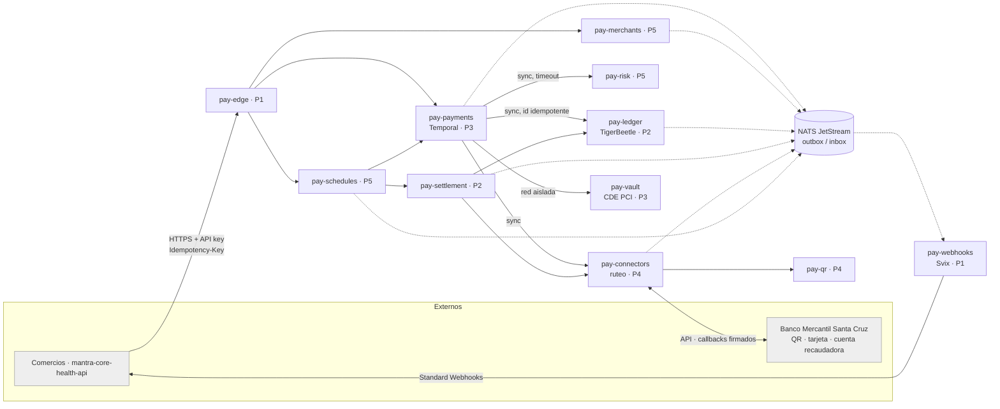

# Plan maestro — Pasarela de pagos ALOVIDA

> **AVANCE: 88 / 109 — 80,7 %.** Ola 3 (endurecimiento) cerrada en esta máquina de 4 vCPU: los 12 servicios con typecheck, build y tests en verde, y
> la suite e2e completa 30 suites / 218 tests con E1–E8 (E3 y E7 incluidos) en un stack real (Postgres, NATS, Redis, Temporal, TigerBeetle, Watchman):
> peldaño **`REGRESSION_VERIFIED`** para lo que cubre esa suite ([corrida](../trabajo/ola-3/integracion/evidencia/e2e-corrida-8-completa.txt)).
> Carga: APRUEBA a 5 rps y NO APRUEBA a 10 y 25 rps por saturación del host, con las invariantes de dinero intactas
> ([diagnóstico](../trabajo/ola-3/integracion/evidencia/carga-diagnostico.md)). Lo bloqueado por algo externo (Q-11/T-03, Svix, mTLS, Jaeger, OpenBao,
> CI en GitHub), el sandbox sobre Compose real y el carril INT están declarados en cada carril. Evidencia en [`../trabajo/`](../trabajo/).
>
> - Fuente del pedido: procesos **7.1–7.9** de `SALUD/📋 Registro de procesos por módulo.md` (bóveda `mantra_core_technologies_health_docs`).
> - Decisiones del dueño: [`DECISIONES.md`](./DECISIONES.md) (D-01 a D-15, tensiones T-01 a T-03 y preguntas abiertas Q-01 a Q-10).
> - Investigación open source y estándares: [`INVESTIGACION.md`](./INVESTIGACION.md).
> - Carriles: [`carriles/`](./carriles/) · Spikes de la ola 0: [`../spikes/`](../spikes/) · Contratos: [`../../contracts/`](../../contracts/).
> - Corte de la API leído: `mantra-core-health-api` `origin/dev` @ `4e64353a` (módulo `payments`: 3 controllers, 14 rutas, 53 entidades).

## 1 · Qué se pide y cómo se cubre

| Proceso | Pide el stakeholder | Lo resuelve | Carril |
|---|---|---|---|
| 7.1 | Registro de las empresas que usan la pasarela | `pay-merchants`: alta, KYC, estados | P5 |
| 7.2 | Contrato legal con cada empresa | `pay-merchants`: contrato versionado y aceptación inmutable | P5 |
| 7.3 | % de comisión acordado | Tarifario completo (D-07): `pay-merchants` lo define, `pay-payments` cotiza, `pay-ledger` asienta | P5 · P3 · P2 |
| 7.4 | Toda compra y venta pasa por la pasarela | API pública `pay-edge` + `pay-payments`; el monolito pasa a ser cliente (D-12) | P1 · P3 · INT |
| 7.5 | Emisión de QR propia | `pay-qr` (EMVCo MPM) + conector del banco adquirente | P4 |
| 7.6 | Seguridad para los socios | `pay-risk`, `pay-vault`, webhooks firmados, mTLS, OpenBao, PCI desde el día uno (D-13) | P5 · P3 · P1 |
| 7.7 | El médico programa sus pagos mensuales | `pay-schedules` + medio «saldo AloVida» | P5 · P2 |
| 7.8 | Los proveedores programan sus comisiones a ALOVIDA | `pay-schedules` + `pay-settlement` (neteo) | P5 · P2 |
| 7.9 | Comisión menor por operar directo | Tarifa por canal (canal «directo») | P5 |

## 2 · Modo de operación

**Modo A — orquestador (D-02), pasarela propia (D-16).** AloVida no revende a un PSP: se integra directo con el **Banco Mercantil Santa Cruz** (QR interoperable, adquirencia de tarjetas y cuenta recaudadora), emite su
propio QR, lleva el libro mayor de cada comercio y le paga desde una cuenta recaudadora. El modo B
(adquirente) queda como doble detrás de `settlement.mode`.

**Condición de salida a producción (T-03):** no se mueve dinero real hasta que existan la cuenta
recaudadora y el visto bueno de la asesoría legal sobre el encuadre en el reglamento del BCB
(RD 079/2022). Hasta entonces, todo corre contra el simulador.

**Sandbox y producción (D-26).** `PAY_MODE=sandbox|live`. En `sandbox` los cobros van a `pay-mockbank`, las claves son
`sk_test_…` y toda respuesta lleva `X-Pay-Mode: sandbox`; nada mueve dinero. En `live` el conector `mock` se niega a cargar
y el sistema no arranca si está configurado. El mock cumple el mismo contrato que el conector real
(`contracts/openapi/internal-connectors-v1.yaml`) y se prueba con los mismos tests, de modo que cuando el Banco Mercantil
entregue credenciales (Q-01, Q-11) el cambio sea de configuración. Un doble **nunca** se presenta como el banco real.

## 3 · Arquitectura

### 3.1 Servicios (11 de producto + 1 de sandbox)

| Servicio | Responsabilidad (lo que nadie más hace) | Almacén | Dueño |
|---|---|---|---|
| `pay-edge` | Única puerta pública: API key (hash), *rate limit*, forma, `Idempotency-Key` obligatoria en los POST, enrutamiento. Sin lógica de negocio. | Postgres `pay_edge` + Redis | P1 |
| `pay-webhooks` | Webhooks salientes Standard Webhooks sobre **Svix**. | Postgres de Svix | P1 |
| `pay-payments` | Intención de pago, máquina de estados, sagas en **Temporal** (cobro, reembolso, anulación, disputa), idempotencia de negocio, cotización con el tarifario replicado, medios de pago. | Postgres `pay_payments` + Temporal | P3 |
| `pay-vault` | Bóveda de tarjetas: tokeniza el PAN y es lo único que lo ve. Se adopta `hyperswitch-card-vault`. Red aislada. | Su propio Postgres cifrado + OpenBao | P3 |
| `pay-connectors` | Interfaz `Connector` y un adaptador por proveedor (simulador, Mercantil QR, Mercantil tarjeta, transferencia); ruteo por reglas; verificación de callbacks; consulta de estado. | Postgres `pay_connectors` + OpenBao | P4 |
| `pay-qr` | QR EMVCo MPM estático y dinámico, perfil boliviano, CRC16, vencimiento. | Postgres `pay_qr` | P4 |
| `pay-ledger` | Partida doble sobre **TigerBeetle**: cuentas, retenciones en dos fases, saldos, extractos, medio «saldo AloVida», exportación a M16. Único que conoce saldos. | TigerBeetle + Postgres `pay_ledger` | P2 |
| `pay-settlement` | Corte semanal, payouts (`PayoutRail`), abono mensual y comisiones (neteo), conciliación (`camt.053` o CSV), excepciones. | Postgres `pay_settlement` | P2 |
| `pay-merchants` | Alta, KYC, contrato versionado, tarifario completo, API keys, estados del comercio. | Postgres `pay_merchants` + almacén de objetos (KYC) | P5 |
| `pay-risk` | Reglas y límites, cribado de sanciones con **moov Watchman**, decisión `allow / review / deny`. | Postgres `pay_risk` | P5 |
| `pay-schedules` | Mandatos y pagos programados (7.7), comisiones programadas (7.8). | Postgres `pay_schedules` | P5 |
| `pay-mockbank` | **Solo sandbox (D-26).** Banco simulado con la misma interfaz que el conector real: QR, tarjeta, transferencia, extractos y callbacks firmados, con escenarios deterministas por importe. Se niega a arrancar con `PAY_MODE=live`. | Postgres `pay_mockbank` | P4 |

### 3.2 Reglas de separación (no negociables)

1. **Una base por servicio, con credenciales propias.** Ningún servicio lee la base de otro. CI lo prueba (REQ-P1-7).
2. **Un despliegue, una imagen y un pipeline de CI por servicio**, aunque compartan repo (D-01). Un servicio no importa código de otro servicio: solo `contracts/` y las librerías técnicas `@pay/*`.
3. **Solo dos formas de hablar:** HTTP interno con contrato OpenAPI, o eventos CloudEvents sobre NATS JetStream con contrato AsyncAPI.
4. **En el camino del cobro, un salto síncrono como máximo** desde `pay-payments`, con *timeout*, *circuit breaker* y política escrita ante una caída.
5. **Datos de otro servicio = réplica por eventos** (tarifario y estado del comercio en `pay-payments` y `pay-edge`).
6. **Outbox en todo productor, inbox en todo consumidor.** Entrega al menos una vez y efecto una sola vez.
7. **El dinero se mueve solo en `pay-ledger`.** **El PAN solo existe en `pay-vault`.**
8. **mTLS entre servicios.** `pay-vault` vive en una red de Coolify a la que solo llega `pay-payments`.

### 3.3 Plan de cuentas del ledger (contrato de P2, congelado en la ola 0)

| Cuenta | Por | Invariante |
|---|---|---|
| `merchant:{id}:pending` | comercio | — (cobrado, sin liquidar) |
| `merchant:{id}:available` | comercio | `debits_must_not_exceed_credits` |
| `user:{id}:wallet` | usuario AloVida (Q-09) | `debits_must_not_exceed_credits` |
| `platform:fees` | plataforma | — (comisiones y abonos, D-07) |
| `connector:{id}:clearing` | conector | — (lo que el PSP o banco nos debe) |
| `payout:clearing` | plataforma | — (payouts emitidos sin confirmar) |
| `schedule:{mandateId}:reserve` | mandato | retención en dos fases (7.7) |

Un cobro QR de Bs 100,00 con 2,5 % + Bs 0,50 fijo deja este asiento:
`connector:banco:clearing` D 100,00 · `merchant:X:pending` C 97,00 · `platform:fees` C 3,00.

### 3.4 Medios de pago (D-03)

| Medio | Cómo entra | Cómo se confirma | Carriles |
|---|---|---|---|
| QR interoperable | `pay-qr` emite el QR dinámico del intento | Callback del banco o consulta de estado | P4 · P3 |
| Tarjeta | Campos alojados del PSP (token del PSP); `pay-vault` si el comercio guarda la tarjeta | Respuesta y callback del PSP | P3 · P4 |
| Transferencia bancaria | Instrucciones con referencia única | Línea del extracto conciliada | P4 · P2 |
| Saldo AloVida | Transferencia interna en el ledger | Inmediata (atómica) | P2 · P3 |

## 4 · Contratos congelados en la ola 0

Viven en `contracts/` (dueño de la forma: P1). Una vez cerrada la ola 0, un cambio que rompe
necesita la aprobación del dueño y de cada consumidor. Los cambios aditivos son libres.

| Contrato | Tipo | Dueño | Consumidores |
|---|---|---|---|
| API pública `v1`: `payment_intents`, `payment_methods`, `refunds`, `merchants/me`, `api_keys`, `webhook_endpoints`, `balance`, `payouts`, `mandates` | OpenAPI 3.1 | P1 (forma) + cada dueño (semántica) | Comercios, INT |
| `internal/risk/v1` | OpenAPI | P5 | P3 |
| `internal/connectors/v1` | OpenAPI | P4 | P3, P2 |
| `internal/vault/v1` | OpenAPI | P3 | P3 |
| `internal/ledger/v1` | OpenAPI | P2 | P3, P5 |
| `internal/settlement/v1` | OpenAPI | P2 | P5 |
| `internal/payments/v1` | OpenAPI | P3 | P5 |
| Eventos `merchant.*`, `fee_schedule.published`, `api_key.*`, `mandate.*`, `scheduled_payment.*` | AsyncAPI | P5 | P1, P2, P3 |
| Eventos `payment_intent.*`, `refund.*`, `dispute.*` | AsyncAPI | P3 | P1, P2, P5 |
| Eventos `connector.*` | AsyncAPI | P4 | P2, P3 |
| Eventos `ledger.*`, `payout.*`, `settlement.*`, `reconciliation.*` | AsyncAPI | P2 | P1, P5 |
| Errores RFC 9457 + catálogo de `code` · sobre CloudEvents | JSON Schema | P1 | Todos |

## 5 · Carriles y reparto

| Carril | Eje | Carpetas | Microtareas | Archivo |
|---|---|---|---|---|
| **P1** | Plataforma, contratos, borde, cumplimiento y E2E sandbox | `contracts/`, `platform/`, `e2e/`, `services/pay-edge`, `services/pay-webhooks`, `docs/cumplimiento/` | 27 | [`P1`](./carriles/P1-plataforma-contratos-y-borde.md) |
| **P2** | Dinero en reposo | `services/pay-ledger`, `services/pay-settlement` | 18 | [`P2`](./carriles/P2-ledger-y-liquidacion.md) |
| **P3** | Ciclo de vida del pago y bóveda | `services/pay-payments`, `services/pay-vault` | 18 | [`P3`](./carriles/P3-nucleo-de-pagos.md) |
| **P4** | Rieles externos y banco simulado | `services/pay-connectors`, `services/pay-qr`, `services/pay-mockbank` | 22 | [`P4`](./carriles/P4-conectores-ruteo-y-qr.md) |
| **P5** | Comercios, riesgo y programados | `services/pay-merchants`, `services/pay-risk`, `services/pay-schedules` | 18 | [`P5`](./carriles/P5-comercios-riesgo-y-programados.md) |
| **INT** | El monolito cobra por la pasarela (ola 5, lidera P3) | `mantra-core-health-api` | 5 | [`INT`](./carriles/INT-monolito-como-cliente.md) |
| | **Total** | | **108** | |

Las carpetas son **disjuntas**: cada programador escribe solo en las suyas. `CODEOWNERS` lo hace
cumplir en los PRs. Los contratos se proponen por PR a `contracts/`, que revisan P1 y los
consumidores.

### 5.1 Olas (las semanas son una **estimación**)

| Ola | Semanas (est.) | Qué pasa | Sale cuando |
|---|---|---|---|
| **0 · Contratos y suelo** | 1 | P1 levanta `platform/` y la plantilla. Cada dueño escribe su contrato y todos revisan los que consumen. *Spikes*: TigerBeetle (P2), Temporal y card vault (P3), APIs del Banco Mercantil Santa Cruz y perfil QR (P4), Watchman (P5), Svix (P1). | Contratos con la etiqueta `v1-frozen`; `docker compose up` sano; el servicio *hello* pasa CI. |
| **1 · Servicios contra dobles** | 2–4 | Cada carril construye contra dobles de los demás, en los tres niveles (regla 65). | Tests unitarios y de integración contra su propia base real en verde. |
| **2 · Integración** | 5–6 | Dobles reemplazados por servicios reales; flujos E1–E6 con el conector simulador. | E1–E6 en verde contra el stack real. |
| **3 · Endurecimiento** | 7–9 | Inyección de fallos, **prueba de carga a 2× 100.000 pagos/día (T-01)**, gates de seguridad, segmentación PCI, *staging* en Coolify multiservidor, conectores del Mercantil si hay credenciales (D-16). | Gates de §7 en verde con evidencia pegada; decisión de despliegue tomada con los números. |
| **4 · Capa sandbox (mock)** | 10–11 | `pay-mockbank`, semillas sintéticas y la suite E2E de un comando (D-26): el sistema completo se prueba **sin credenciales ni configuración externa**, y pasar a producción es cambiar configuración. Carriles P4.H4 y P1.H5. | `yarn e2e` con E1–E8 en verde sobre el stack sandbox; guardia `PAY_MODE=live` demostrada. |
| **5 · Integración del monolito** | 12–13 | Carril INT, ya probado contra el sandbox. | REQ-INT-1 a 3. |

## 6 · Kill-test global y flujos E2E

**Kill-test:** cobrar Bs 100,00 por QR con 2,5 % + Bs 0,50. El ledger tiene que mostrar 97,00 en
`merchant:X:pending` y 3,00 en `platform:fees`, con débitos iguales a créditos. Después: reenviar
el callback 3 veces, repetir el POST con la misma `Idempotency-Key` 3 veces y matar
`pay-payments` a mitad de la saga. Si algún saldo cambia, si aparece un segundo intento o si el
pago no termina en **un solo** estado terminal, no está hecho.

| # | Flujo E2E | Carriles |
|---|---|---|
| E1 | Alta de comercio → KYC → contrato → API key → primer cobro QR | P5 → P1 → P3 → P4 → P2 |
| E2 | Cobro QR con callback duplicado, reordenado y perdido (resuelto por *polling*) | P3 · P4 · P2 |
| E3 | Reembolso parcial con retención y fallo del conector | P3 · P2 · P4 |
| E4 | Corte semanal → payout → conciliación con una diferencia (excepción) | P2 · P4 |
| E5 | Pago mensual del médico con saldo AloVida: sin fondos → reintento → éxito | P5 · P2 · P3 |
| E6 | Webhook al comercio con su endpoint caído; `410` lo deshabilita | P1 |
| E7 | Cobro con tarjeta por los campos alojados del PSP sin un solo PAN fuera de `pay-vault` | P3 · P4 |
| E8 | Transferencia bancaria confirmada por la línea del extracto | P4 · P2 · P3 |

Los ocho se ejecutan en la ola 4 con `yarn e2e` contra el sandbox (D-26). Cada flujo usa un importe que dispara un escenario concreto de `pay-mockbank` (tabla en P4.H4.M3).

## 7 · Gates comunes (todo servicio, antes de cerrar la ola 3)

| Gate | Cómo se demuestra |
|---|---|
| Typecheck, lint y unitarios | `yarn typecheck && yarn lint && yarn test` del servicio, con la salida pegada |
| Integración contra base real | Postgres (y TigerBeetle en P2) del Compose; nunca el ORM mockeado |
| Contrato | Tests de consumidor generados desde OpenAPI y AsyncAPI, contra el proveedor real |
| Idempotencia | Cada mutación repetida N veces en paralelo → un solo efecto |
| Autorización negativa | Otro comercio, sin clave, clave revocada, `test` contra `live` → 401/403/404 sin filtrar existencia |
| Separación | Arranca con un usuario de base sin permisos sobre las demás |
| Datos sensibles | Sin PAN, CVV, documento ni nombre en logs, trazas, eventos ni errores; grep pegado |
| PCI | El servicio figura en `docs/cumplimiento/pci-alcance.md` con su clasificación |
| Deriva de esquema | Modelo ↔ base ↔ entidades sin deriva (Q-03) |
| Observabilidad | Traza OTel de E1 de punta a punta en Jaeger |
| Fallos | Experimento de inyección de fallos documentado |
| Carga | Su parte del objetivo de T-01, medida |
| Sandbox | (ola 4) Sus flujos E2E pasan contra `pay-mockbank` y los tests de contrato del conector son idénticos para el simulador y el real |

## 8 · Riesgos

| Riesgo | Impacto | Mitigación |
|---|---|---|
| Sin cuenta recaudadora ni visto bueno legal (T-03) | No se puede operar | Condición de salida a producción, no de desarrollo. P1.H4.M2 prepara el cuestionario. |
| Volumen objetivo contra Coolify (T-01) | Caída en producción | Prueba de carga en la ola 3 con criterio escrito de antemano; Kubernetes como plan B. |
| TigerBeetle no encaja | P2 se frena | *Spike* en la ola 0. Alternativas: Formance, Blnk o un ledger en Postgres. |
| `hyperswitch-card-vault` no encaja | Sin bóveda | Hasta resolverlo, solo campos alojados del PSP (el PAN no nos toca). |
| Contratos mal congelados | Retrabajo en cadena | Revisión cruzada obligatoria en la ola 0. |
| 11 servicios para 5 personas | Carga operativa | Plantilla única, CI reutilizable, un Compose. |
| Sin ambiente de pruebas del Mercantil (D-16) | E2E solo contra el simulador | Declarado así; la integración real se verifica aparte. |
| Mock que se desvía del banco real | Un E2E verde que no sirve para producción | Mismos tests de contrato para el simulador y el real (P1.H5.M4); el mock no inventa campos del banco (Q-11); cuando haya credenciales, paridad corrida contra el real. |
| Redondeo de comisiones (D-20) | Dinero perdido | `@pay/money` + test de propiedades (comisión + neto = bruto). |
